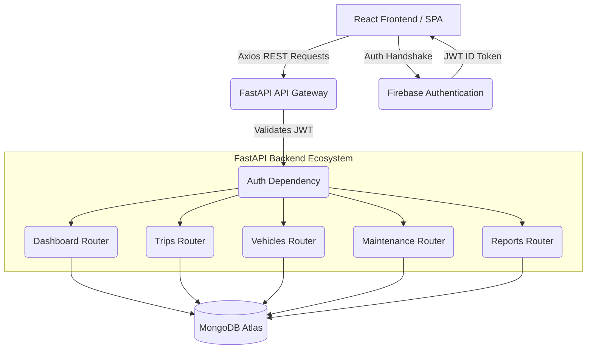
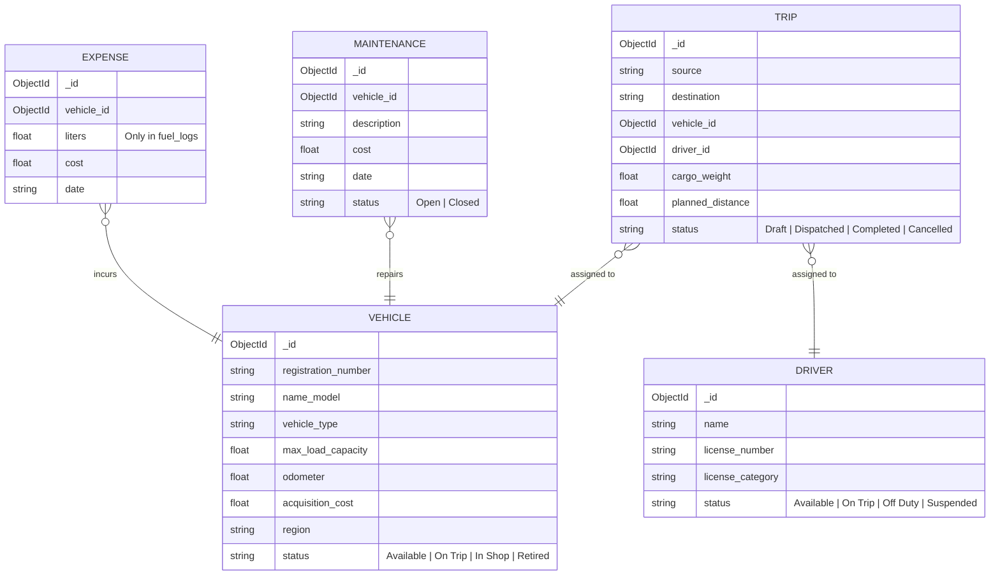

<div align="center">
  
  <h1>🚌 TransitOps</h1>
  <p><b>Enterprise-Grade Fleet Management & Logistics Ecosystem</b></p>
  
  [](https://www.python.org/)
  [](https://fastapi.tiangolo.com/)
  [](https://www.mongodb.com/)
  [](https://reactjs.org/)
  [](https://firebase.google.com/)
</div>

<hr/>

## 📖 Table of Contents
1. [Platform Overview](#-platform-overview)
2. [Comprehensive Feature Set](#-comprehensive-feature-set)
3. [System Architecture](#-system-architecture)
4. [Database Schema & ERD](#-database-schema--erd)
5. [Technology Stack](#-technology-stack)
6. [Core Business Logic](#-core-business-logic)
7. [Deep-Dive: Directory Structure](#-deep-dive-directory-structure)
8. [Installation & Local Deployment](#-installation--local-deployment)
9. [API Ecosystem](#-api-ecosystem)

<hr/>

## 🌐 Platform Overview

**TransitOps** is a highly scalable, full-stack fleet management and logistics platform designed for transportation enterprises. It centralizes operations by linking **Vehicles, Drivers, Trips, Maintenance, and Finances** into a unified ecosystem. 

Rather than basic CRUD operations, TransitOps implements a **smart state-machine**. For instance, dispatching a trip automatically flags the assigned vehicle and driver as `On Trip`. Sending a vehicle to the garage automatically marks it `In Shop`, preventing it from being double-booked.

<hr/>

## ✨ Comprehensive Feature Set

TransitOps comes packed with enterprise-ready features designed to eliminate logistical bottlenecks and digitize the entire fleet lifecycle.

### 1. 🔒 Authentication & Role-Based Access Control (RBAC)
- **Secure Identity Management:** Powered by Firebase Authentication, supporting secure email/password logins and JWT (JSON Web Token) generation.
- **Granular Roles:** Users are strictly segmented into roles like `Fleet Manager`, `Driver`, `Safety Officer`, and `Financial Analyst`. 
- **Protected Routes:** Both the React frontend and FastAPI backend contain middleware that cryptographically verifies JWTs to block unauthorized access.

### 2. 📊 Real-Time Analytics Dashboard
- **Live Fleet KPIs:** Instantly view counts for Active Vehicles, Available Vehicles, Vehicles in Maintenance, and Pending/Active Trips.
- **Dynamic Fleet Utilization:** Automatically calculates the percentage of your operable fleet currently deployed on the road.
- **Advanced Filtering:** Slice and dice your KPI data by specific regions or vehicle types to identify localized operational bottlenecks.

### 3. 🚛 Advanced Vehicle Registry
- **Master Roster:** A centralized hub to track Registration Numbers, Models, Types, and Maximum Load Capacities.
- **Financial & Operational Tracking:** Keep precise records of a vehicle's Acquisition Cost and current Odometer reading.
- **Automated Statuses:** Vehicles fluidly transition between `Available`, `On Trip`, `In Shop`, and `Retired` based on real-world events.

### 4. 🧑‍✈️ Driver Profiling & Safety Management
- **Compliance Tracking:** Monitors License Numbers, Categories, and Expiry Dates to ensure legal compliance before dispatch.
- **Performance Metrics:** Stores driver Safety Scores to aid in high-risk route assignments.
- **Real-Time Availability:** Ensures drivers cannot be double-booked. Their status toggles automatically based on their assigned trips.

### 5. 📍 Smart Trip Dispatch & Lifecycle Management
- **End-to-End Tracking:** Trips move through a rigorous lifecycle: `Draft ➔ Dispatched ➔ Completed ➔ Cancelled`.
- **Intelligent Validation:** The system refuses to create a trip if the assigned cargo weight exceeds the vehicle's physical load capacity.
- **Ghost-Booking Prevention:** Only vehicles and drivers currently marked as `Available` can be selected for new trips.

### 6. 🛠️ Maintenance & Garage Workflows
- **Repair Logging:** Record descriptions, repair dates, and repair costs for individual vehicles.
- **Automated Sidelining:** The moment a maintenance log is opened, the vehicle is instantly pulled from the active dispatch pool (marked `In Shop`). Closing the ticket restores its availability.

### 7. ⛽ Operational Expense & Fuel Tracking
- **Granular Cost Logging:** Dedicated ledgers for Fuel Logs (tracking liters and costs) and General Expenses (tolls, parking, repairs).
- **Automated Aggregation:** The backend dynamically aggregates all expenses per vehicle to provide a real-time Total Operational Cost metric.

### 8. 📈 Financial Reporting & Exports
- **One-Click CSV Streaming:** Instantly export your entire fleet's operational data into a formatted Excel/CSV file without hitting disk limits (streams directly from memory).
- **Algorithmic Insights:** The reporting engine auto-calculates advanced metrics like **Fuel Efficiency (km/L)** and **Vehicle ROI** based on historical fuel consumption and acquisition costs.

<hr/>

## 🏗 System Architecture

The ecosystem relies on a decoupled architecture, separating the client-side Single Page Application (SPA) from the backend API services, secured via Firebase Identity Provider.



<hr/>

## 🗄 Database Schema & ERD

TransitOps utilizes **MongoDB** via `PyMongo` for its flexible document model, which perfectly suits rapidly changing logistics data.



<hr/>

## 💻 Technology Stack

### Backend Infrastructure
| Technology | Purpose |
|------------|---------|
| **FastAPI** | High-performance asynchronous web framework for Python. Chosen for its automatic Swagger UI generation and Pydantic validation. |
| **PyMongo** | Official MongoDB driver for Python, handling dynamic JSON document structures. |
| **Pydantic (V2)** | Enforces strict type hinting, payload validation, and enum boundaries for incoming REST data. |
| **Firebase Admin** | Verifies JWT tokens cryptographically to ensure that endpoints are completely secure. |
| **Uvicorn** | Lightning-fast ASGI server for handling concurrent network requests. |

### Frontend Infrastructure
| Technology | Purpose |
|------------|---------|
| **React 19** | Modern UI library utilizing Context API for global auth state management. |
| **Vite** | Next-generation frontend tooling providing rapid HMR (Hot Module Replacement) and optimized build bundles. |
| **React Router DOM** | Manages application routing and protected route wrappers. |
| **Axios** | Robust HTTP client for handling API interactions and intercepting requests to inject Bearer tokens. |
| **CSS Modules** | Custom, lightweight Vanilla CSS styling. |

<hr/>

## 🧠 Core Business Logic

TransitOps enforces strict domain logic to ensure data integrity across the fleet.

1. **State-Driven Trip Lifecycle**
   - **Validation:** Prevents trip creation if `cargo_weight` > Vehicle's `max_load_capacity`.
   - **Cascading:** Dispatching a `Draft` trip automatically sets the linked Driver and Vehicle to `On Trip`. Completing the trip reverts them to `Available`.
2. **Automated Maintenance Locking**
   - Opening a maintenance ticket immediately pulls the vehicle off the road by setting its status to `In Shop`.
3. **Role-Based Access Control (RBAC)**
   - Security middleware verifies users and validates roles prior to executing sensitive mutations.

<hr/>

## 📂 Deep-Dive: Directory Structure

```text
transitops/
├── backend/
│   ├── main.py                  # Entry point; wires all routers & sets up CORS
│   ├── configurations.py        # MongoDB connection instances & index generation
│   ├── deps.py                  # FastAPI dependencies (JWT Auth verification)
│   ├── auth/                    # Auth syncing & Role management controllers
│   ├── models/                  # Pydantic Schemas (Enforces data integrity)
│   │   ├── vehicle.py
│   │   ├── driver.py
│   │   ├── trip.py
│   │   ├── maintenance.py
│   │   └── expense.py
│   └── routers/                 # API Endpoints (The nervous system)
│       ├── dashboard.py         # Aggregates KPIs & Fleet Utilization metrics
│       ├── trips.py             # Lifecycle transitions (Dispatch/Complete)
│       ├── reports.py           # In-memory CSV streaming & Analytics math
│       └── ...
│
└── frontend/
    ├── vite.config.js           # Build settings
    ├── index.html               # Entry point for SPA
    └── src/
        ├── api/                 # Axios clients for interacting with backend routes
        ├── components/          # Reusable UI components (Sidebar, Layouts)
        │   └── ProtectedRoute.jsx # Wrapper that blocks unauthenticated access
        ├── context/             # AuthContext.jsx (Global user state & Firebase listeners)
        ├── pages/               # Main views (Dashboard, Trips, Vehicles, Reports)
        └── firebase.js          # Firebase client initialization
```

<hr/>

## ⚙️ Installation & Local Deployment

### 1. Database & External Services Setup
1. Create a free **MongoDB Atlas** cluster.
2. Create a **Firebase Project** and enable Email/Password Authentication.
3. Download the Firebase Admin SDK private key (`.json`) for the backend.

### 2. Backend Initialization
```bash
# 1. Enter backend directory
cd backend

# 2. Setup Virtual Environment
python -m venv venv
source venv/bin/activate  # (Windows: venv\Scripts\activate)

# 3. Install Dependencies
pip install -r requirements.txt

# 4. Environment Variables
cp .env.example .env
# Open .env and add:
# MONGO_URI=mongodb+srv://<user>:<password>@cluster.mongodb.net/?retryWrites=true&w=majority
# DB_NAME=transitops

# 5. Boot the ASGI Server
uvicorn main:app --reload --port 8000
```
> 📚 The autogenerated API Documentation (Swagger) will be live at `http://localhost:8000/docs`.

### 3. Frontend Initialization
```bash
# 1. Enter frontend directory
cd frontend

# 2. Install NPM packages
npm install

# 3. Environment Variables
cp .env.example .env
# Open .env and map your Firebase Client Keys:
# VITE_API_URL="http://127.0.0.1:8000"
# VITE_FIREBASE_API_KEY="..."
# VITE_FIREBASE_AUTH_DOMAIN="..."
# ...

# 4. Start Development Server
npm run dev
```
> 💻 The React UI will be live at `http://localhost:5173`.

<hr/>

## 🔌 API Ecosystem (Overview)

The backend provides a rich RESTful API. Below are the primary controllers:

- **`GET /dashboard/kpis`**: Aggregates fleet statistics, active trips, and calculates total fleet utilization percentage. Supports filtering by region and vehicle type.
- **`POST /trips/`**: Validates capacities and generates a Draft trip.
- **`PUT /trips/{id}/dispatch`**: Mutates the Trip, Vehicle, and Driver states simultaneously ensuring atomic-like logistical shifts.
- **`GET /reports/export`**: Compiles total fuel costs, calculates km/L, and streams a formatted `.csv` blob to the client.
- **`POST /maintenance/`**: Logs a repair cost and automatically sidelines the target vehicle to `In Shop`.

---
<div align="center">
  <p>Built with ❤️ for modern logistics.</p>
</div>
